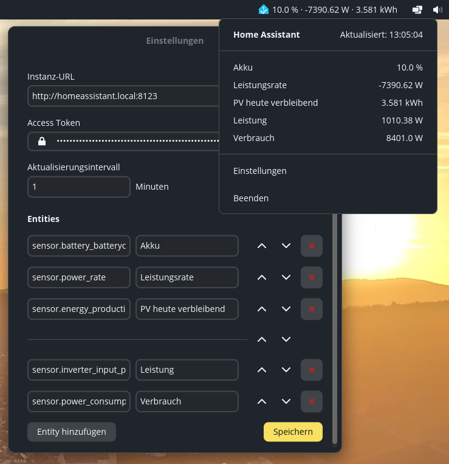

# cosmic-applet-homeassistant

A native **COSMIC panel applet** that displays a configurable list of
[Home Assistant](https://www.home-assistant.io/) entities directly in the panel.



## Install (user-local, from source)

Requires Rust plus system packages (`libwayland-dev`, `libxkbcommon-dev`, …).

```bash
cargo build --release
./install.sh
```

Then add the *Home Assistant* applet to a panel wing in
**Settings → Panel → Applets**.

## Configuration

All settings are configured in the applet's own settings window
(popup → *Settings*): instance URL, long-lived access token, refresh
interval (minutes, default 1) and the entity list (entity ID + display
name, add/remove/reorder).

The **boundary line** in the entity list marks what appears in the
panel next to the logo: entities above the line are shown in the panel
(initially all of them), the complete list is always shown in the
popup. Move entities across the line with the arrow buttons; the line
itself moves with its own arrows.

Everything is persisted in

```
~/.config/cosmic-applet-homeassistant/config.toml   (permissions 0600)
```

To create a token: Home Assistant → profile → security → *Long-Lived
Access Tokens*. Environment variables (`HOME_ASSISTANT_URL`/`HA_URL`,
`HOME_ASSISTANT_TOKEN`/`HA_TOKEN`) only act as fallback for values not
yet set in the settings window.

Entity values are polled via REST (`GET /api/states/<entity_id>`)
at the configured interval. Changes saved in the settings window are
picked up within about a second (config-file watcher) — no restart
needed.

## Development

```bash
cargo test
cargo clippy --all-targets -- -D warnings
```

## Localization

English is the source locale; German is included and selected automatically
from your desktop locale. Set `I18N_LANGUAGE` (e.g. `en` or `de`) to override.
